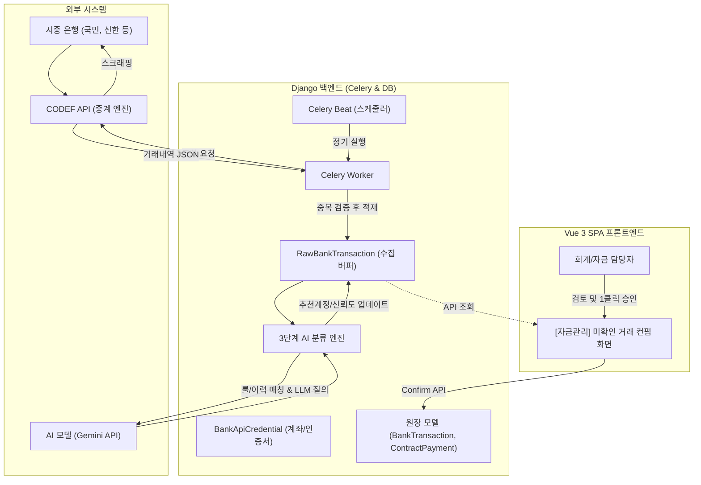

# CODEF 기반 은행 거래내역 자동 수집 및 AI 회계 분류 구현 로드맵

본 문서는 IBS 시스템에 **코드에프(CODEF) API**를 연동하여 은행 거래내역을 자동으로 수집하고, **AI/규칙 기반 잠정 계정과목 분류**를 거쳐 **담당자 원클릭 컨펌 및 원장 반영**까지 완성하는 단계별 실전 구축 계획입니다.

---

## 📌 전체 시스템 아키텍처 개요



---

## 📅 단계별 세부 로드맵

### Phase 0: 사전 준비 및 POC (1~2일)
> **목표**: 비용 발생 없이 CODEF 개발자 환경에서 실제 통신 및 계좌 조회 검증 완료

1. **CODEF 개발자 센터 세팅**
   - [codef.io](https://codef.io) 기업/개발자 회원가입
   - 데모 프로젝트 생성 및 인증 키 발급 (`CLIENT_ID`, `CLIENT_SECRET`, `PUBLIC_KEY`)
   - 1개월 무료 데모(실계좌 일 100회) 권한 확보
2. **테스트 대상 계좌 및 인증서 선정**
   - 개발/테스트용 법인 공동인증서(또는 특정 은행 빠른조회용 계좌) 1~2개 확보
3. **환경 변수 및 패키지 설정**
   - Django `.env`에 CODEF 인증 키 설정
   - 필수 라이브러리 추가 (`cryptography`, `requests`)

---

### Phase 1: 데이터 모델 및 보안 인프라 구축 (2~3일)
> **목표**: 안전한 인증 정보 관리와 수집 데이터를 격리 보관할 버퍼(Staging) 모델 구축

1. **데이터 모델 정의 (`ledger/models_scraping.py` 신설)**
   - `BankApiCredential`: 법인/프로젝트 은행계좌와 CODEF의 `connectedId` 매핑
   - `RawBankTransaction`: 은행에서 내려온 가공 전 원시 거래내역 테이블
2. **중복 수집 방지(Idempotency) 구조 구현**
   - 은행 거래는 고유 PK가 없으므로 `SHA-256(계좌번호 + 일자 + 시간 + 구분 + 금액 + 잔액 + 적요)` 해시 필드(`tx_hash`)를 생성하여 유니크 인덱스 부여
3. **보안 암호화 적용**
   - 계좌 비밀번호 등 민감정보는 `cryptography.fernet` 대칭키 암호화 필드 적용
   - 인증서 파일은 서버에 저장하지 않고 CODEF `connectedId` 발급에만 일회성 사용
4. **마이그레이션 실행**
   - `python manage.py makemigrations ledger`
   - `python manage.py migrate`

---

### Phase 2: CODEF 통신 클라이언트 & Celery 수집 자동화 (3~4일)
> **목표**: 사람의 개입 없이 정해진 시각에 은행 거래내역이 자동으로 DB에 쌓이도록 구현

1. **CODEF API 클라이언트 모듈 개발 (`ledger/services/codef_client.py`)**
   - OAuth 2.0 액세스 토큰 자동 발급 및 Redis 캐싱 (유효기간 1주일)
   - RSA 공개키 암호화 유틸리티 구현
   - 계정 등록 API (`/v1/account/create`) 연동
   - 거래내역 조회 API (`/v1/kr/bank/b/account/transaction-list`) 연동
2. **Celery 수집 태스크 구현 (`ledger/tasks.py`)**
   - `sync_bank_transactions_task()`: 활성 계좌를 순회하며 최근 2일 치 내역 수집
   - 기존 수집 건은 건너뛰고(`tx_hash` 확인), 신규 건만 `RawBankTransaction`에 저장
3. **Celery Beat 스케줄 등록 (`_config/celery.py` 또는 DB Periodic Task)**
   - 평일(월~금) 08:30, 13:00, 17:30 (하루 3회 자동 실행으로 월 비용 완전 고정)
4. **예외 처리 및 로깅**
   - 은행 점검 시간(자정 전후), 인증서 만료, 비밀번호 오류 시 상태 기록 및 관리자 알림

---

### Phase 3: 3단계 AI 잠정 회계계정 분류 파이프라인 (3~4일)
> **목표**: 수집된 거래 데이터의 성격을 분석하여 추천 계정과 신뢰도(Confidence) 자동 부여

```mermaid
flowchart LR
    RAW[원시 거래내역] --> R1{1단계: 룰 매칭}
    R1 -->|일치 (신뢰도 98%)| DONE[분류 완료]
    R1 -->|미일치| R2{2단계: 과거 이력}
    R2 -->|일치 (신뢰도 90%)| DONE
    R2 -->|미일치| R3{3단계: LLM 추론}
    R3 -->|추론 (신뢰도 산출)| DONE
```

1. **1단계: 건설 도메인 룰 엔진 (정규식/패턴)**
   - **분양대금 매칭**: 입금자명 패턴(`"101-1002 홍길동"`, `"101동 1002호"`) 파싱 → `contract.Contractor` / `contract.Contract` 검색 → `ProjectAccount(is_payment=True)` 자동 세팅
   - **고정 금융비용**: 적요에 "수수료", "타행이체", "이자" 포함 시 해당 계정 매칭
2. **2단계: 과거 이력 패턴 매칭 (History Matching)**
   - 최근 6개월간 동일 적요/거래처명으로 승인된 거래내역의 계정과목 우선 추천
3. **3단계: LLM(Gemini API) 지능형 추론**
   - 모호한 지출 적요(예: "현장 폐기물 수거", "인허가 관련 공증료") 분석
   - 회사 계정과목 목록 중 가장 적합한 1~3순위 계정과목 및 추천 사유 반환
4. **비동기 분류 태스크 연결**
   - `RawBankTransaction` 저장 완료 즉시 백그라운드 태스크로 분류 파이프라인 구동

---

### Phase 4: 프론트엔드 컨펌 UI & 원장 최종 연동 (4~5일)
> **목표**: 담당자가 화면에서 AI 추천 결과를 확인하고 원클릭으로 정식 원장에 반영

1. **DRF API 엔드포인트 개발 (`apiV1/views/ledger.py`)**
   - `GET /api/v1/ledger/raw-transactions/?status=pending`: 미처리 거래 목록
   - `POST /api/v1/ledger/raw-transactions/{id}/confirm/`: 단건 승인
   - `POST /api/v1/ledger/raw-transactions/bulk-confirm/`: 고신뢰도 건 일괄 승인
2. **원장 반영 트랜잭션 로직 (`@transaction.atomic`)**
   - 승인 시 실제 `ProjectBankTransaction` (또는 `CompanyBankTransaction`) 생성
   - 매칭된 계정으로 `ProjectAccountingEntry` 생성
   - 분양대금인 경우 `payment.ContractPayment` 자동 연동 동기화 트리거
   - `RawBankTransaction.status = 'confirmed'` 업데이트
3. **Vue 3 / Vuetify 컴포넌트 개발 (`app/vue/src/views/ledger/`)**
   - **신뢰도 시각화**: 🟢 녹색(90% 이상: 일괄 승인 대상), 🟡 노란색(확인 권장), 🔴 빨간색(수동 선택)
   - **계정 드롭다운**: AI 추천 계정이 기본 선택되어 있고 클릭 한 번으로 변경 가능
   - **일괄 승인 버튼**: 녹색 항목들을 한 번에 원장으로 전송

---

### Phase 5: 운영 전환 및 지속적 최적화 (지속 운영)
> **목표**: 정식 상용화 및 데이터 피드백 루프 구축

1. **CODEF 운영(Production) 계약 전환**
   - 월 1,000~2,000회 트래픽 기준으로 기업 정식 계약 체결
2. **인증서 만료 주기 관리 알림**
   - 공인인증서 만료 30일/7일 전 시스템 대시보드 경고 배너 및 이메일 발송
3. **피드백 학습 루프 (Active Learning)**
   - 담당자가 수정한 계정과목 결과를 룰 엔진 및 AI 프롬프트 예시(Few-shot)로 누적하여 자동 분류 정확도 점진적 향상
4. **복식부기(`accounting`) 앱 도입 연계**
   - 원장 반영 시점에 복식부기 전표(`Voucher`) 자동 발행 파이프라인으로 자연스럽게 확장

---

## ⏱️ 예상 소요 일정 요약 (총 3~4주)

| 주차 | 주요 마일스톤 | 산출물 |
| :--- | :--- | :--- |
| **1주차** | **Phase 0 ~ Phase 1** (사전 준비, 모델링, 보안 인프라) | CODEF 데모 키, DB 모델 및 마이그레이션 |
| **2주차** | **Phase 2** (CODEF 연동 클라이언트, Celery 자동 수집 스케줄러) | 매일 정시 자동 수집되는 원시 거래 DB |
| **3주차** | **Phase 3** (3단계 AI/룰 계정 분류 엔진) | 동호수 파싱 및 Gemini 연동 추천 파이프라인 |
| **4주차** | **Phase 4 ~ Phase 5** (Vue 컨펌 UI, 원장 반영 및 최종 검증) | 원클릭 컨펌 화면 및 payment 연동 완료 |
